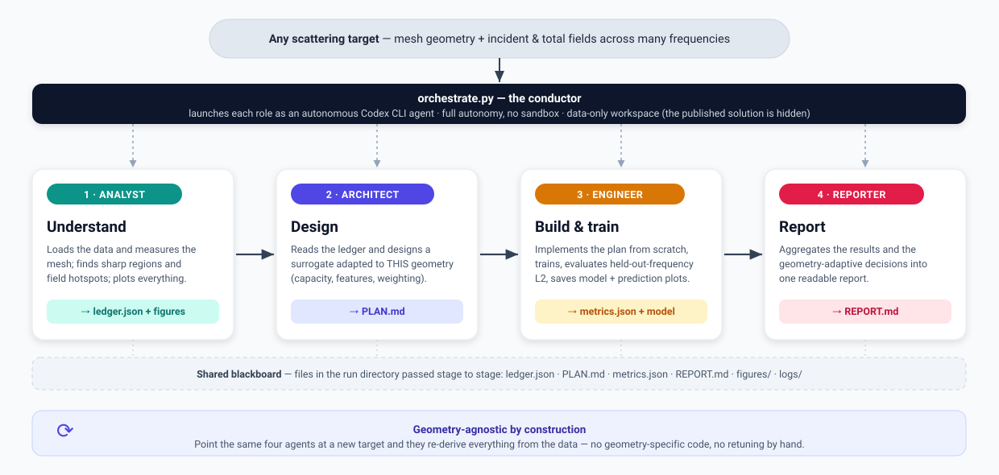
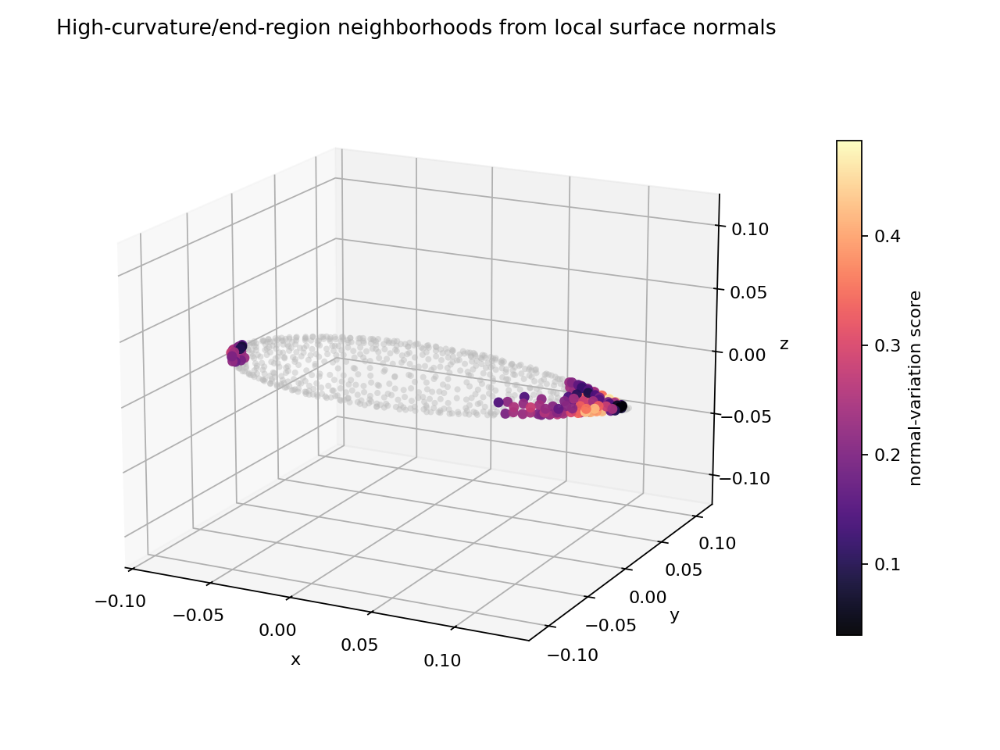
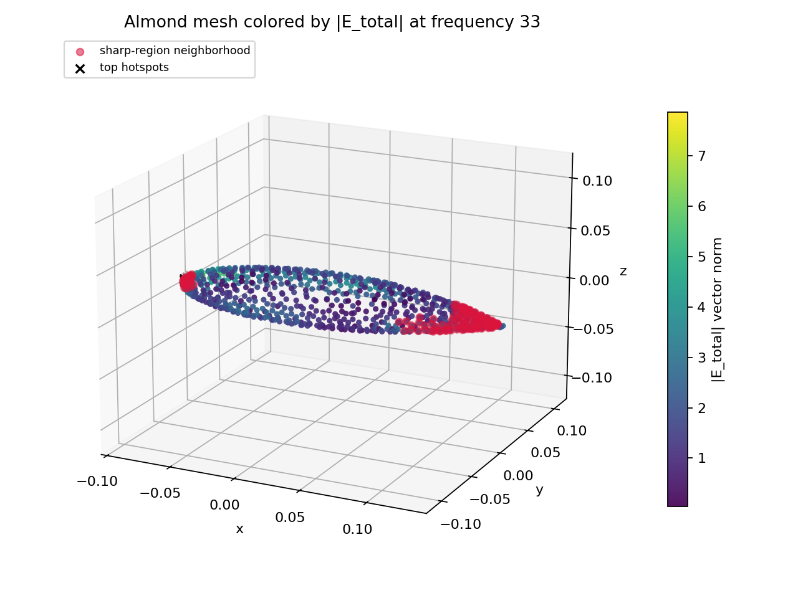

<h1 align="center">Agentic EM-Surrogate Builder</h1>

<p align="center">
  <em>A team of autonomous agents that <b>looks at</b> an electromagnetic scattering dataset,
  <b>understands the geometry</b>, and builds a field-prediction surrogate from scratch —
  for <b>any</b> target, with no geometry-specific code.</em>
</p>

<p align="center">
  
</p>

---

## What this is

The published model in this repository (`../sphere`, `../almond`) solves one problem: given an
**incident** electromagnetic field, predict the **total** field over a fixed mesh — and do it at
**frequencies the model never trained on**, for a metallic scattering target.

This branch solves the *same* problem a different way. Instead of a hand-written solution, a small
team of **autonomous [Codex](https://developers.openai.com/codex/cli/) agents** does the work: they
read the raw data, **measure and visualize the geometry**, decide how to model it, write and train
the network, and report the result. A Python conductor (`orchestrate.py`) launches each agent and
passes a shared *blackboard* of files between them.

> The published solution is **never shown to the agents**. Each run directory contains the **data
> only**, so the surrogate is genuinely (re)derived — not copied.

## Why it's interesting

- **It understands the geometry before it models it.** The first agent doesn't guess — it *measures*.
  Mesh extent, surface-vs-volume, **where the surface is sharp**, **where the field concentrates**,
  how hard the frequency interpolation looks. Every number in its ledger is computed from the actual
  data. Nothing is hard-coded and nothing is fabricated.
- **The agents act differently for different shapes.** A smooth sphere and a pointed almond lead the
  same agents to *different* design decisions — because the decisions are driven by what was measured,
  not by the target's name (see the worked example below).
- **It generalizes by construction.** Drop in a new geometry and the same four agents re-derive
  everything. Sphere and almond are just two instances of one pipeline.
- **Full autonomy, no sandbox.** Each agent is a real Codex CLI process that installs its own
  dependencies, writes code, trains models, and saves figures — end to end, no human in the loop.

## How it works

Four role-specialized agents run in sequence; each reads what the previous one wrote:

| Stage | Agent | What it does | Hands off |
|------:|-------|--------------|-----------|
| 1 | **Analyst** | Loads the data and **measures + plots** the geometry and fields. The heart of the system. | `ledger.json` + figures |
| 2 | **Architect** | Reads the ledger and **designs a surrogate adapted to this geometry**. | `PLAN.md` |
| 3 | **Engineer** | Implements the plan **from scratch**, trains, evaluates held-out-frequency error. | `metrics.json` + model |
| 4 | **Reporter** | Aggregates the results and the geometry-adaptive decisions. | `REPORT.md` |

---

## Worked example: the agents discover the almond's tip

Here is the **Analyst** running on the NASA-almond target. It was handed nothing but the raw field
files. By computing local surface normals across the point cloud, it **discovered the high-curvature
end-regions on its own** — the colored points below are where the measured normal-variation is high:

<p align="center">
  
</p>

It then looked at the fields and found that the **strongest electric field sits exactly on that sharp
tip** — the red concentration and hotspot markers at the pointed end:

<p align="center">
  
</p>

That is the whole point: the field **singularity coincides with the geometric singularity**, and the
agent *measured* this rather than being told. From the ledger (every value computed from the data):

> aspect ratio **7.94** · classified as a **thin surface shell** · mirror symmetry in **y and z only**
> · **two high-curvature end-regions** detected · largest `|E|` = **8.97**, located **on** the negative-x
> tip (`in sharp/end region: True`) · **7 of the 10** strongest-field points lie in the sharp regions.

Because of these measurements, the Analyst raises concrete flags for the downstream Architect —
**`has_singularity: true`**, **`recommend_pointwise_loss_weighting: true`**,
**`recommend_feature_richness: high`** — i.e. *put extra modeling effort on the tip*.

### Same agents, different shape, different decisions

Run the **identical** pipeline on the sphere and the measurements — and therefore the decisions —
come out the opposite way. No code changed between these two runs:

| What the Analyst measured | 🟢 Sphere | 🔶 Almond |
|---|---|---|
| Aspect ratio | 1.001 | **7.94** |
| Mirror symmetry | x, y, z | **y, z only** |
| Sharp/high-curvature regions | **none found** | **two end-regions** |
| Strongest field on a sharp region? | n/a | **yes — on the tip** |
| `has_singularity` | `false` | **`true`** |
| `recommend_pointwise_loss_weighting` | `false` | **`true`** |
| `recommend_feature_richness` | `medium` | **`high`** |
| → Architect's design | modest model, **no** up-weighting, sphere-aware radial features | up-weight the **tip**, richer features |

For the sphere the full pipeline ran end to end — the Architect chose a compact model and added radial
features from the measured centroid/radius, and the Engineer trained it and evaluated per-component
relative-L2 on the held-out frequencies. The differences above were produced entirely by the measured
ledger.

---

## Run it

```bash
codex login                                   # one-time (uses your subscription; no API keys)

python orchestrate.py --smoke --geometry sphere   # fast end-to-end demo (minutes)
python orchestrate.py --smoke --geometry almond
python orchestrate.py --full                      # all targets, full settings
python orchestrate.py --list                      # list registered geometries
```

Outputs land in `runs/<geometry>/`: `LEDGER.md`, `PLAN.md`, `metrics.json`, `REPORT.md`, the trained
model, and a `figures/` gallery. Runs are resumable (each completed stage is recorded).

**Add a new geometry** by adding one entry to `REGISTRY` in `datasets.py` (its data folder, file
globs, and frequency coordinate). Nothing else changes — the agents analyze and adapt to it
automatically.

## Repository layout

| File | Role |
|------|------|
| `orchestrate.py` | the conductor — launches the four Codex agents and passes the blackboard |
| `datasets.py` | geometry-agnostic dataset registry (sphere, almond preconfigured) |
| `prompts.py` | the four role prompts (Analyst / Architect / Engineer / Reporter) |
| `PROBLEM.md` | the geometry-agnostic problem statement + data format + metric |
| `AGENTS.md` | the Codex operating manual (full autonomy, isolation, blackboard formats) |
| `assets/` | the workflow diagram and example figures used in this page |

<sub>Requires the Codex CLI (<code>npm install -g @openai/codex</code>) and Node 18+. The Engineer agent
installs its own ML dependencies on first run. The orchestrator itself is pure Python standard
library.</sub>
